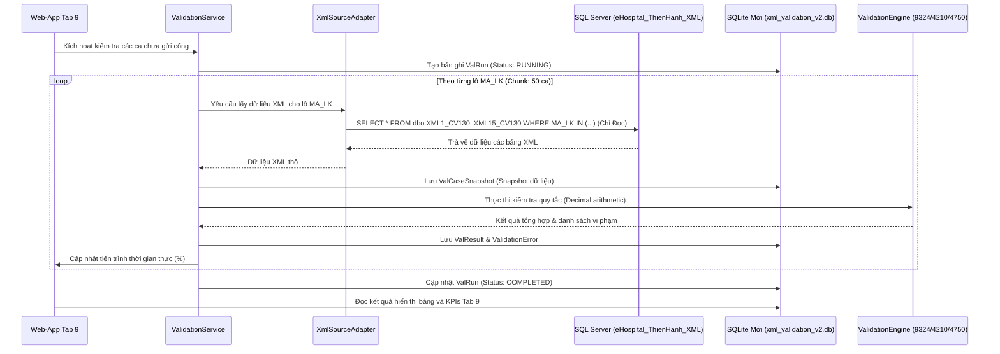

# TÀI LIỆU ĐẶC TẢ KỸ THUẬT: HỆ THỐNG VALIDATE XML ĐỘC LẬP TẠI TAB 9 (V2)
*Hệ thống Kiểm Tra Lỗi Hồ Sơ XML BHYT Tự Động Từ CSDL HIS — Dự án CHECKBHYT*

Tài liệu này mô tả chi tiết yêu cầu kỹ thuật, kiến trúc độc lập, các quy tắc nghiệp vụ kiểm tra và phương thức tích hợp cho hệ thống **XML Validator V2** thay thế mô-đun cũ tại Tab 9.

---

## 📌 1. Nguyên tắc thiết kế mô-đun (Độc lập & An toàn CSDL)

> [!IMPORTANT]
> **Yêu cầu cốt lõi:**
> 1. Hoàn toàn độc lập với Nhánh A (đối soát `HoSoLoiChiTiet.xlsx`, bảng `records`, `error_definitions`). Không làm thay đổi kết quả hay trạng thái của Nhánh A.
> 2. **Chế độ CHỈ ĐỌC (Read-Only), Column Projection & Parameterized Query:** Truy vấn dữ liệu từ CSDL `eHospital_ThienHanh_XML` bằng câu lệnh `SELECT cols FROM dbo.{tbl} {lock_hint} WHERE MA_LK IN (?, ?, ?)` với tham số hóa `tuple(chunk)` chuẩn ODBC và danh mục cột cần thiết (`XML_TABLE_COLUMNS`). Chống SQL Injection, tối ưu RAM/IO và tương thích Python 3.10/3.11+. Tuyệt đối **không gọi Stored Procedure tạo lại XML**, không thực thi bất kỳ lệnh `INSERT`, `UPDATE`, `DELETE` nào trên SQL Server viện.
> 3. **Quản lý trạng thái đọc theo từng hồ sơ (`case_table_status`) & Ma trận bảng phụ thuộc:** Ghi nhận trạng thái đọc riêng biệt cho từng ca (`SUCCESS`, `EMPTY`, `ERROR`). Bảng nào lỗi truy vấn thì mọi quy tắc phụ thuộc theo ma trận `RULE_REQUIRED_TABLES_MAP` bắt buộc trả về `INCOMPLETE_DATA`, triệt tiêu hoàn toàn rủi ro báo đạt sai (False Negative).
> 4. **Vùng lưu trữ SQLite riêng:** Sử dụng tệp `xml_validation_v2.db` với các bảng có tiền tố `val_*`, tách biệt hoàn toàn với `app_state.db`.
> 5. **Catalog 123 quy tắc:** Bao gồm 116 quy tắc logic gốc (9324, 4210, 4750) và 7 nhóm quy tắc CTN 4750.

*   **Tính độc lập:** Mô-đun nằm trong package `web_app/xml_validator_v2/` với Source Adapter, Rule Engine, Service và Router riêng.
*   **Cơ chế kích hoạt:** Kích hoạt kiểm tra cho các hồ sơ **chưa gửi thành công lên cổng** từ đợt đối soát hiện tại hoặc theo khoảng ngày (áp dụng bộ lọc `or_(Record.status != 'RESOLVED', Record.status.is_(None))`).
*   **Cơ chế đầu ra:** Hiển thị trên giao diện Tab 9 mới, tra cứu chi tiết vi phạm từng hồ sơ, xuất báo cáo Excel (`report_exporter.py`).
*   **Bảo vệ hủy tiến trình:** Quản lý `CURRENT_VALIDATION_PROGRESS` qua cơ chế in-place dictionary, bảo đảm trạng thái `CANCELLED` không bị ghi đè thành `COMPLETED`.

---

## 🛠️ 2. Luồng xử lý kỹ thuật của Mô-đun



---

## 📋 3. Nguồn dữ liệu XML từ CSDL Bệnh Viện (CV 130)

Hệ thống truy vấn trực tiếp từ CSDL `eHospital_ThienHanh_XML` trên SQL Server `thsrvsql01` theo mã nghiệp vụ `MA_LK`:
*   **Các cột khóa liên kết ghi nhận trong metadata:** `BenhAn_Id`, `TiepNhan_Id`, `BenhNhan_Id`, `XacNhanChiPhi_Id`, `MA_LK`. Toàn bộ 15 bảng XML con đều mang khóa ngoại nghiệp vụ là `MA_LK`.
*   **Danh sách đủ 15 bảng XML theo Quyết định 4750 / CV 130:**
    *   **XML1_CV130 (Bảng 1):** Chỉ tiêu tổng hợp khám bệnh, chữa bệnh (Hành chính, loại KCB, tổng chi, viện phí, BHTT chi trả).
    *   **XML2_CV130 (Bảng 2):** Chỉ tiêu chi tiết thuốc thanh toán BHYT (Số lượng, đơn giá, tỷ lệ thanh toán, thành tiền).
    *   **XML3_CV130 (Bảng 3):** Chỉ tiêu chi tiết dịch vụ kỹ thuật và vật tư y tế (Mã nhóm, số lượng, stent, tiền giường, tiền vận chuyển).
    *   **XML4_CV130 (Bảng 4):** Chỉ tiêu kết quả cận lâm sàng (quy mô gần 16 triệu dòng).
    *   **XML5_CV130 (Bảng 5):** Chỉ tiêu theo dõi diễn biến lâm sàng.
    *   **XML6_CV130 (Bảng 6):** Hồ sơ bệnh án trích tóm tắt.
    *   **XML7_CV130 (Bảng 7):** Giấy ra viện / Giấy chuyển tuyến.
    *   **XML8_CV130 (Bảng 8):** Tóm tắt hồ sơ bệnh án (áp dụng điều trị nội trú / ban ngày).
    *   **XML9_CV130 (Bảng 9):** Giấy chứng sinh.
    *   **XML10_CV130 (Bảng 10):** Bảng kê chi phí KCB bổ sung.
    *   **XML11_CV130 (Bảng 11):** Giấy nghỉ dưỡng thai.
    *   **XML12_CV130 (Bảng 12):** Giấy chứng nhận nghỉ việc hưởng BHXH.
    *   **XML13_CV130 (Bảng 13):** Giấy khám chữa bệnh định kỳ.
    *   **XML14_CV130 (Bảng 14):** Thông tin hẹn khám lại / Giấy hẹn khám lại.
    *   **XML15_CV130 (Bảng 15):** Chi tiết thông tin nhân thân người bệnh.

---

## 🔍 4. Danh Mục 116 Quy Tắc Kiểm Tra Lỗi Đa Chuẩn (Rule Catalog)

Trích xuất toàn diện từ 2 tài liệu chính thức (`GDH_Danh sách các mã lỗi Chặn hồ sơ sai logic.docx` và `TLGDH_Danh sách mã lỗi chặn hồ sơ sai Logic theo 4750.docx`), phân tách rạch ròi 3 chuẩn:
1. **Chuẩn 9324 (12 quy tắc):** Áp dụng theo Công văn 9324 (Mã 1, 3, 4, 5, 8, 9, 10, 11, 12, 14, 60, 61).
2. **Chuẩn 4210 (50 quy tắc):** Áp dụng theo Quyết định 4210 (Mã 1, 8-11, 14-27, 31, 34-46, 47-56, 58, 60, 61, 101, 104-106).
3. **Chuẩn 4750 (54 quy tắc):** Áp dụng theo Quyết định 4750 (Mã 1, 8-11, 14-27, 31, 34-40, 43-44, 47-56, 58, 60, 61, 108-119).

### Nhóm A: Kiểm tra lỗi định dạng và Ràng buộc bắt buộc (Không để trống)

| STT | Mã lỗi XML | Thẻ cần kiểm tra | Logic kiểm tra của Agent | Mô tả lỗi hiển thị |
| :---: | :---: | :--- | :--- | :--- |
| **A1** | **XML1** | `<MA_BENH_CHINH>`| Bắt buộc có giá trị. Trimming khoảng trắng, không được rỗng. | `MA_BENH_CHINH không được để trống` |
| **A2** | **XML1** | `<NAM_QT>` | Bắt buộc có giá trị (Năm quyết toán). | `NAM_QT không được để trống` |
| **A3** | **XML2** | `<MA_THUOC>` | Bắt buộc có giá trị đối với mọi bản ghi thuốc. | `MA_THUOC không được để trống` |
| **A4** | **XML3** | `<MA_BAC_SI>` | Bắt buộc có mã bác sĩ chỉ định/thực hiện dịch vụ. | `MA_BAC_SI không được để trống` |
| **A5** | **XML4** | `<MA_BS_DOC_KQ>`| Bắt buộc có mã bác sĩ đọc kết quả cận lâm sàng. | `MA_BS_DOC_KQ không được để trống` |
| **A6** | **XML5** | `<DIEN_BIEN_LS>`| Bắt buộc có nội dung diễn biến lâm sàng của bệnh nhân. | `DIEN_BIEN_LS không được để trống` |
| **A7** | **XML5** | `<NGUOI_THUC_HIEN>`| Bắt buộc nhập người thực hiện theo dõi diễn biến. | `NGUOI_THUC_HIEN không được để trống` |
| **A8** | **XML8** | `<MA_TTDV>` | Bắt buộc có mã trạng thái dịch vụ trong tóm tắt bệnh án.| `MA_TTDV không để trống` |
| **A9** | **XML8** | `<TOMTAT_KQ>` | Bắt buộc có tóm tắt kết quả bệnh án. | `TOMTAT_KQ không được để trống` |
| **A10**| **XML8** | `<PP_DIEUTRI>` | Bắt buộc có phương pháp điều trị của đợt bệnh. | `PP_DIEUTRI không được để trống` |
| **A11**| **XML8** | `<CHAN_DOAN_RV>`| Bắt buộc nhập chẩn đoán lúc ra viện. | `CHAN_DOAN_RV không được để trống` |
| **A12**| **XML9** | `<MA_TTDV>` | Bắt buộc có mã trạng thái dịch vụ trong bảng kê chi phí.| `MA_TTDV không được để trống` |
| **A13**| **XML13**| `<HO_TEN>` | Bắt buộc nhập họ tên bệnh nhân trong hồ sơ khác. | `HO_TEN không được để trống` |
| **A14**| **XML0** | `<MA_DICH_VU>` | Thẻ dịch vụ kỹ thuật không được để trống. | `MA_DICH_VU không được để trống` |
| **A15**| **XML0** | `<MA_VAT_TU>` | Thẻ mã vật tư y tế không được để trống. | `MA_VAT_TU không được để trống` |
| **A16**| **XML0** | `<MA_THUOC>` | Thẻ mã thuốc không được để trống. | `MA_THUOC không được để trống` |
| **A17**| **XML1** | `<LY_DO_VV>` | Nếu lý do vào viện là "Người bệnh không KCB BHYT" thì báo lỗi. | ` sai lý do: Người bệnh không KCB BHYT ` |

### Nhóm B: Kiểm tra logic thời gian và Định dạng chuỗi (Regex)

| STT | Mã lỗi XML | Thẻ cần kiểm tra | Logic kiểm tra của Agent | Mô tả lỗi hiển thị |
| :---: | :---: | :--- | :--- | :--- |
| **B1** | **XML4** | `<NGAY_KQ>` | Phải định dạng `YYYYMMDDHHMM` và giá trị phải `≤` thời gian hệ thống hiện tại lúc quét file. | `NGAY_KQ không được lớn hơn thời gian hiện tại` |
| **B2** | **XML7** | `<NGOAITRU_TUNGAY>`| *(Đã lược bỏ)* Giá trị ngày bắt đầu điều trị ngoại trú phải `≤` ngày ra viện `<NGAY_RA>` ở tệp XML1 có cùng `<MA_LK>`. | *(Đã lược bỏ)* `NGOAITRU_TUNGAY không được lớn hơn NGAY_RA` |
| **B3** | **XML3** | `<NGAY_YL>` | Ngày y lệnh dịch vụ phải `≥` ngày vào viện `<NGAY_VAO>` trong tệp XML1 có cùng `<MA_LK>`. | `ngày y lệnh trước ngày vào viện.` |
| **B4** | **XML3** | `<TT_THAU>` | Định dạng thông tin thầu phải khớp biểu thức quy định: `Quyết định;Gói thầu;Nhóm thầu;...`. Nếu chuỗi không chứa đúng số lượng ký tự phân tách hoặc sai năm đấu thầu, báo lỗi. | `TT_THAU sai định dạng quy định`<br>`TT_THAU sai - Sai năm đấu thầu` |
| **B5** | **XML2** | `<TT_THAU>` | Tương tự quy tắc B4 nhưng áp dụng cho thẻ thầu thuốc trong tệp XML2. | `TT_THAU sai định dạng quy định`<br>`TT_THAU sai - Sai năm đấu thầu` |

### Nhóm C: Kiểm tra liên kết logic chéo (Cross-file Validation)

| STT | Tệp kiểm tra | Tệp đối chiếu | Logic kiểm tra chéo của Agent | Mô tả lỗi hiển thị |
| :---: | :---: | :---: | :--- | :--- |
| **C1** | **XML3** | **XML4** | Với mỗi bản ghi dịch vụ trong XML3 có nhóm chi phí `<MA_NHOM>` = 2 (Cận lâm sàng / CĐHA), bắt buộc trong tệp XML4 có cùng `<MA_LK>` phải tồn tại bản ghi kết quả cận lâm sàng tương ứng và trường `<KET_LUAN>` của bản ghi đó không được rỗng. | `KET_LUAN không được để trống khi XML3.MA_NHOM = 2.` |
| **C2** | **XML3** | **XML3** | Nếu bản ghi dịch vụ kỹ thuật trong XML3 có mã nhóm `<MA_NHOM>` nhận một trong các giá trị `[1, 2, 3, 8, 18]`, bắt buộc thẻ `<NGUOI_THUC_HIEN>` phải có giá trị. | `NGUOI_THUC_HIEN không được để trống khi mã nhóm bằng 1 2 3 8 18` |
| **C3** | **XML2** | **XML3** | Đối chiếu toàn bộ danh mục mã thuốc/mã dịch vụ điều trị `<MA_DICH_VU>` được kê trong XML2 (Chi tiết thuốc) xem mã này có khớp và nằm trong danh mục dịch vụ kỹ thuật đã chỉ định tại XML3 của bệnh nhân đó hay không. | `MA_DICH_VU <MÃ_DV> không nằm trong XML3.` |
| **C4** | **XML1** | **XML7** | Kiểm tra trường loại hình KCB `<MA_LOAI_KCB>` trong XML1. Nếu nhận giá trị `[3, 4, 9]` (Điều trị ngoại trú ban ngày, nội trú,...), bắt buộc phải có sự hiện diện của tệp XML7 (Giấy ra viện) của hồ sơ đó. | `MA_LOAI_KCB ở XML1 = 3,4,9 thì phải có XML7 (giấy ra viện).` |
| **C5** | **XML1** | **Mọi XML** | Tệp XML1 chứa thông tin định danh chính. Nếu XML1 bị lỗi định dạng nghiêm trọng (không phân tích cú pháp được) hoặc thiếu các thông tin cốt lõi, dừng ngay việc kiểm tra các tệp XML liên quan của hồ sơ này. | `Thông tin XML1 chưa chuẩn xác. Hệ thống tạm dừng check các XML liên quan.` |

---

## 💻 5. Cấu trúc thư mục mã nguồn đề xuất của công cụ độc lập

Agent lập trình nên tổ chức cấu trúc dự án độc lập như sau:

```text
xml-validator-module/
│
├── config.json             # Cấu hình đường dẫn thư mục Input/Output, cổng chạy service
├── main.py                 # Điểm khởi chạy chính (Quét thư mục hoặc chạy API Web Server)
├── watcher.py              # Sử dụng thư viện 'watchdog' giám sát thư mục Input tự động
├── xml_parser.py           # Phân tích cú pháp XML, nhóm file XML1-XML13 theo mã MA_LK
├── rule_engine.py          # Chứa toàn bộ logic kiểm tra của 26 quy tắc ở trên
├── report_generator.py     # Xuất kết quả phân tích lỗi ra file Excel (TongHopLoi.xlsx) và JSON
└── requirements.txt        # Các thư viện phụ thuộc (lxml, pandas, openpyxl, watchdog)
```

---

## 🔌 6. Hướng dẫn tích hợp cho Web-App chính

Mô-đun độc lập này cung cấp 2 phương thức tích hợp cho Web-App chính của bạn:

1.  **Tích hợp dựa trên sự kiện File (File-based Integration):**
    *   Web-app chính cấu hình xuất các tệp XML cần xử lý vào thư mục `Input/`.
    *   Mô-đun Python watcher phát hiện file, phân tích tự động trong nền (background) và tạo ra tệp kết quả `ket_qua.json` trong thư mục `Output/`.
    *   Web-app chính thiết lập cơ chế giám sát thư mục `Output/` hoặc nhận webhook/tín hiệu từ Python để đọc tệp `ket_qua.json` này và hiển thị giao diện báo cáo lỗi cho người dùng cuối.
2.  **Tích hợp qua HTTP REST API (API-based Integration):**
    *   Mô-đun Python chạy một API Web Server siêu nhẹ (ví dụ dùng `FastAPI` hoặc `Flask` chạy trên cổng `localhost:8000`).
    *   Web-app chính gửi yêu cầu POST: `POST http://localhost:8000/validate` với tham số là đường dẫn thư mục chứa tệp XML.
    *   Mô-đun Python xử lý đồng bộ hoặc bất đồng bộ và trả về kết quả cấu trúc lỗi dưới dạng JSON trực tiếp cho Web-app chính xử lý.
